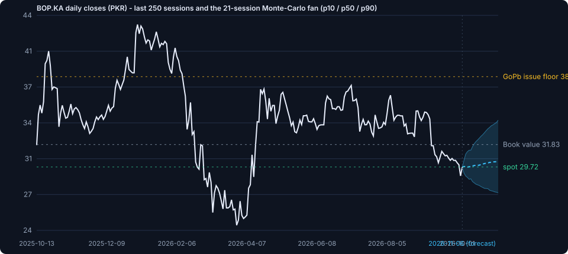
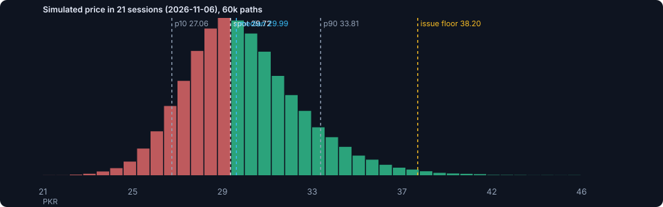

# The Bank of Punjab (PSX: BOP) - deep research and 30-day movement forecast

**Forecast date:** 2026-10-07 · **Last settled close:** PKR 29.72 (2026-10-06) ·
**Forecast horizon:** 2026-10-07 to 2026-11-06 (21 trading sessions) ·
**Engine:** TradingAgents multi-agent pipeline (vendored at `TradingAgents/`) with the PSX
data and forecasting layer in `psx/`.

---

## 1. The call

> **30-day movement prediction: modestly higher, wide band.** Probability that BOP closes above
> PKR 29.72 on 2026-11-06: **54%**. Median terminal price
> **PKR 29.99**
> (+0.9%), expected value **PKR 30.25**
> (+1.8%). The 80% interval is PKR 27.06 to
> PKR 33.81; the interquartile band is PKR 28.41 -
> PKR 31.80. Committee rating: **Hold**, sized at
> 4.1% of a diversified book with a stop at
> PKR 27.31.

| Metric | Value |
|--------|-------|
| Spot (last settled close, 2026-10-06) | PKR 29.72 |
| Median forecast (2026-11-06) | PKR 29.99 |
| Expected value | PKR 30.25 |
| Probability of a higher close | 54% |
| 80% interval | PKR 27.06 - 33.81 |
| 5% VaR / CVaR over the window | -11.6% / -14.6% |
| P(touch the PKR 38.20 GoPb issue floor) | 0.9% |
| Daily volatility (EWMA) / annualised | 2.06% / 32.8% |

**Scenario book**

| Scenario | Probability | Price range | Midpoint | Return |
|----------|-------------|-------------|----------|--------|
| Bull | 27% | PKR 32.50 - 36.50 | PKR 34.40 | +15.7% |
| Base | 46% | PKR 28.00 - 32.50 | PKR 30.40 | +2.3% |
| Bear | 27% | PKR 24.00 - 28.00 | PKR 26.60 | -10.5% |

Probability-weighted value: **PKR 30.45** (+2.5%). The Monte-Carlo mean
(PKR 30.25) and the scenario book (PKR 30.45) agree within ~1%, which is a
useful cross-check: two independent constructions of the same view land in the same place.

**Why not a stronger call?** Because the two dominant forces point in opposite directions. Value
and capital structure are exceptionally supportive - the controlling shareholder is contracted to
buy up to Rs 30bn of new equity at no less than PKR 38.20, 29% above spot and
20% above audited book, while the stock trades at 0.93x book on a ~10% dividend
yield. Macro and politics are not: inflation at 10.26% has the money market pricing another hike
on 26 October, and the government-PTI standoff is driving a 12%-off-the-high index in which banks
are ~25% of the weight. A one-month horizon is short enough that the second force can dominate.

---

## 2. Where the price is now

*History from the validated daily snapshot (`data/`), fan from 60,000 Monte-Carlo paths.*

* **Trend:** below SMA20 (30.73), SMA50 (32.80), SMA100
  (33.72) and SMA200 (34.02); RSI(14) 36;
  MACD histogram -0.046 (negative, flattening).
* **Drawdown:** -31.0% below the 5 January 2026 intraday high of
  44.17; max two-year drawdown -44%.
* **Returns:** 1 month -14.7%, 3 months -17.4%, 12 months -7.3%,
  2 years +472%.
* **Risk:** realised vol 34% (20d) / 51%
  (250d) annualised; 1-day historical VaR(95) 4.3%; ATR(14)
  PKR 0.83. Returns are fat-tailed (excess kurtosis
  +2.3) and positively skewed
  (+0.51).
* **Microstructure:** the 5 Oct down day traded 7.3mn shares versus a 19.5mn three-month average,
  and 6 Oct reversed from 28.55 to close 3.2% off its low - supply is thinning at support.
* **Key levels:** support 28.55 / 27.00-28.00 (May-June base); resistance 30.90-31.75 (September
  range top), 33.70-34.46 (200-day average and July swing), then 38.20 (the issue floor).

---

## 3. Forecast distribution

| Threshold | Model probability of being at or above on 2026-11-06 |
|-----------|------------------------------------------------------|
| PKR 33.70 (200-DMA / prior support turned resistance) | 10.6% |
| PKR 34.46 (Jul-2026 swing close) | 7.2% |
| PKR 36.40 (GoPb issue price net of the 5% premium) | 2.5% |
| PKR 38.20 (GoPb equity-injection floor) | 0.9% |
| PKR 44.17 (all-time high, Jan-2026) | 0.0% |
| PKR 27.00 (May/Jun-2026 base) | 90.5% |
| PKR 24.26 (52-week low area) | 99.5% |

The distribution is generated by block-bootstrapping 250 sessions of the stock's own returns
(blocks of five sessions preserve volatility clustering), scaling them to today's EWMA volatility
of 2.06% per day, and mixing three drift regimes: a zero-drift martingale
(weight 35%), a weak pull toward the 200-day average (50%) and a small catalyst overlay (15%).
The martingale leg alone puts P(up) at 48%; the mixture lands
at 54%. Anyone who believes short-horizon drift is unknowable should read the
martingale number as the honest floor - even then the downside is bounded by a support shelf that
the state-owned anchor shareholder has a contractual incentive to defend.

---

## 4. Deep research: the evidence base

### 4.1 Company-specific

| Fact | Source | Date |
|------|--------|------|
| Record H1-2026: operating profit Rs 22.5bn (+67%), PBT Rs 20.5bn (+35%), PAT Rs 9.5bn (+40%) | BOP press release via Pro Pakistani / Dawn / The Nation / Khyber News, 2026-08-28/31 | 2026-08-28 |
| Quarterly PAT: Q2-2026 Rs 4.756bn, 5% below Q2-2025 (Rs 5.007bn) as Q1 carried H1 growth | PSX company financials (dps.psx.com.pk) via the quarterly PAT series | 2026-08-28 |
| PACRA upgraded BOP to AAA (long term) with A1+ short term, stable outlook, on 1 Jul 2026 | PACRA via Profit/Tribune/Mettis Global, 2026-07-01 | 2026-07-01 |
| Shareholders approved up to Rs 30bn of equity from the Government of Punjab at a PKR 38.20 floor | BOP EOGM disclosure; Daily Times / The Friday Times / Pro Pakistani, 2026-09-08/09 | 2026-09-08 |
| The equity plan was preceded by unusual trading: +9% on ~158mn shares in the three sessions to 7 Aug | Bloom Pakistan / PSX disclosures, 2026-08-10 | 2026-08-10 |
| Interim dividend of 16% declared with H1-2026, dispatched 24 Sep 2026; ex-date 10 Sep 2026 | PSX company announcements (dps.psx.com.pk); Profit/Cybernet; stockanalysis.com | 2026-09-24 |
| Largest SME, agriculture, low-cost housing and women-entrepreneurship lender; largest card issuer | BOP release; Business Recorder trends; Pro Pakistani 2026-04-14 | 2026-08-06 |
| Majority government ownership is the structural risk: 57.47% Punjab government stake | koalagains.com stock analysis; BOP EOGM materials | 2026-09-08 |

### 4.2 Sector

| Fact | Source | Date |
|------|--------|------|
| System deposits Rs 39.24trn (+13.9% y/y) in Aug 2026; advances Rs 13.61trn (+10.7%) | Topline Securities via Pro Pakistani 2026-10-05 / 24NewsHD 2026-10-06 | 2026-10-05 |
| System ADR stuck at 34.7% (35.7% a year earlier) - lending is not keeping pace | Topline Securities; BOP H1-2026 results release | 2026-10-05 |
| Bank corporate tax steps down to 42% for TY2027; 10% super tax above Rs 150mn remains | The News / Express Tribune (Dec 2024); pkrevenue.com 2026-07-19; PwC Finance Bill 2026 memo | 2026-07-19 |

### 4.3 Macro

| Fact | Source | Date |
|------|--------|------|
| SBP policy rate 11.5%, on hold since the 100bp hike of 27 Apr 2026 | pakera.pk SBP calendar; Trading Economics; SBP MPC statements | 2026-10-05 |
| CPI 10.26% y/y in Sep 2026 (Aug 11.1%), still above the 5-7% target band | pakera.pk; archyde.com (citing Dawn), 2026-10-04 | 2026-10-05 |
| Money market prices a hike: 1-year T-bill cut-off up to 12.49%, 12M KIBOR 12.68% | pakera.pk; Tresmark commentary via archyde.com | 2026-10-05 |
| SBP reserves $21.44bn (25 Sep 2026), total liquid $26.77bn, import cover >3 months | Business Recorder, 2026-10-01; Eurasia Review, 2026-09-18 | 2026-10-01 |
| IMF projects FY27 GDP growth of 3.5% against the government's 4% target | Business Recorder editorial, 2026-07-16; BOP FX rate sheet, 2026-10-02 | 2026-07-16 |
| Government-PTI standoff and the long march are the live domestic risk factor | The Express Tribune, 2026-10-06; pakera.pk, 2026-10-05 | 2026-10-06 |

### 4.4 Scorecard

| Dimension | Score | Comment |
|-----------|-------|---------|
| Valuation | 8/10 | 0.93x audited book (BVPS 32.77 at 2Q-2026), ~5.3x TTM / ~6x forward earnings, ~10.4% dividend yield versus a 44.60 consensus target and a 38.20 contracted issue price. |
| Earnings Momentum | 7/10 | H1-2026 PAT +40% y/y and operating profit +67%, but Q2-2026 was 5% BELOW Q2-2025 - the growth is front-loaded and the Q3 comparison is harder. |
| Balance Sheet | 6/10 | CAR 13.69% is adequate but the thinnest of the large banks (Tier-1 Rs 99.9bn against Rs 2,952bn of assets); the injection fixes that, subject to approvals. |
| Franchise | 7/10 | PACRA AAA, policy-driven priority-sector dominance, ADR ~44-46% versus 34.7% system, largest card issuer - but concentrated in one province. |
| Macro Tailwind | 5/10 | Reserves and rating upgrades are supportive; inflation at 10.3% and a possible hike are not. |
| Technical | 4/10 | Downtrend below all moving averages, but oversold, with the last two sessions showing accumulation-style reversals. |
| Sentiment | 5/10 | Consensus Strong Buy with a 44.60 target contrasts with a market punished by political risk; flow data show only token foreign selling. |
| Governance | 5/10 | AAA-rated and professionally run, yet 57.47% government-owned with directed-lending exposure - and the +9% run-up before the injection was disclosed. |

---

## 5. The multi-agent committee

The pipeline below mirrors the vendored TradingAgents graph (analysts -> bull/bear debate ->
research manager -> trader -> risk debate -> portfolio manager). The deterministic engine applies
explicit rules to the same data tools and emits these artifacts; to execute the *actual* LangGraph
pipeline instead, run `python scripts/run_bop_assessment.py --framework` (deterministic stand-in
model when no key is present) or `... --framework --mode live` with an LLM API key set. The
framework's own report tree is written to `reports/framework/BOP_2026-10-07/`.

### Analyst reports

### Market Analyst - technical read

**Price structure.** Last settled close **PKR 29.72** (2026-10-06). The stock is
**-31.0% below** the January 2026 all-time intraday high of 44.17 and has lost
-14.7% over the last month. It trades below every major
average: SMA20 30.73, SMA50 32.80, SMA100 33.72,
SMA200 34.02 - a clean bearish alignment.

**Momentum.** RSI(14) 35.9 (weak, not yet capitulated); MACD -0.957 versus
signal -0.912, histogram -0.046 (negative but flattening -
the rate of deterioration is slowing).

**Volatility & risk.** Realised vol 34% (20d) and 51% (250d)
annualised; ATR(14) PKR 0.83 (~2.8% of price); Bollinger %B
0.25 with the lower band at 28.69. One-day historical VaR(95)
4.3%, CVaR(95) 6.9%.

**Levels.** Recent swing lows [30.01, 31.65, 32.32] and the 2026-10-06 low of 28.55 form
the support shelf; the 200-day average at 34.02 and the July swing close of 34.46 are
the first real resistance, then the GoPb issue floor at 38.20.

**Volume.** The 5 Oct down day traded 7.3mn shares against a three-month average near
19.5mn, and 6 Oct closed 4.1% off its low on 8.5mn shares -
supply is drying up into support rather than accelerating.

### Fundamentals Analyst - valuation and earnings

**Valuation.** At PKR 29.72: market cap ~PKR 97bn,
**0.93x** the audited break-up value of PKR 31.83 and **5.3x** trailing EPS of 5.59
(~4.5x forward on consensus). A ~Rs 3.00 trailing dividend is a **10.1%**
yield. The contracted Government of Punjab issue price of **PKR 38.20** is 29%
above the market - i.e. the largest shareholder is buying new equity at a premium to book.

**Earnings power.** H1-2026 was the best half in the bank's history: operating profit
Rs 22.5bn (+67% y/y), PBT Rs 20.5bn (+35%), PAT Rs 9.5bn (+40%), NII Rs 46.1bn (+29%) and
non-markup income ex-gains Rs 11.9bn (+61%). Cost-to-income improved 2.40pp. Deposits reached
Rs 2,154bn with current accounts +20% y/y; gross advances grew 28% to Rs 996bn, implying an
ADR near 46% against a system average of 34.7%.

**Capital.** CAR 13.69% and a 3.65% leverage ratio clear the regulatory floor but leave BOP the
thinnest large bank in Pakistan (Tier-1 PKR 99.9bn). The approved Rs 30bn injection, at a floor
of PKR 38.20, would lift book value per share from 31.83 to roughly 33.1 before any deployment
- **+4% of book for existing holders** - at the cost of up to ~24% more shares.

**Quality.** Government of Punjab schemes are 18% of the portfolio but only 3% of NPLs, with
97-100% recovery; the group NPL ratio of ~8% still trails private peers by a wide margin, and
PACRA's AAA (A1+, stable) upgrade on 1 Jul 2026 recognises the improved franchise.

### News Analyst - macro and event tape

**What is driving the tape.** Government-PTI standoff and the long march are the live domestic risk factor -> The KSE-100 fell 2,288 points (-1.36%) on 5 Oct 2026 amid political noise and speculation about constitutional measures, with oil at $101-103/bbl and renewed Strait of Hormuz / Red Sea tension adding to risk aversion.

**The event calendar inside the forecast window.**

| Date | Event | Why it matters |
|------|-------|----------------|
| 2026-10-26 | BOP Q3-2026 results AND the SBP MPC decision land on the SAME DAY - a double event inside the forecast window | |
| 2026-11-06 | 30-day forecast horizon end | |
| 2026-12-31 | Deadline for the first GoPb tranche (Rs 15-20bn of shares) | |

**Score split.** Macro tape 3.5/10, company newsflow 7.4/10
(equal-weighted) - the tape is hostile while the company flow is strongly positive.

**Macro balance.** Supportive: SBP reserves $21.44bn (25 Sep 2026), total liquid $26.77bn, import cover >3 months.
Hostile: CPI 10.26% y/y in Sep 2026 (Aug 11.1%), still above the 5-7% target band - Sep CPI rose 1.27% m/m with housing/electricity/gas +3.05%. The Jul-Sep average was 10.20%. FY27 inflation is projected near 7.5% at $80 oil and 8.2% at $100 oil.
The policy rate has been on hold at 11.5% since the
100bp hike in April 2026, and the money market is pricing a further hike (1-year T-bill cut-off
12.49%, 12M KIBOR 12.68%), so the 26 Oct MPC is a two-sided risk rather than a free option.

**Company newsflow.** The GoPb equity injection (approved 8 Sep 2026), PACRA's AAA upgrade
(1 Jul 2026), the highest-ever 16% interim dividend (dispatched 24 Sep 2026) and the Bahrain
wholesale-banking unit are all recent positives. Two caveats: Q2-2026 PAT (Rs 4.756bn) was 5%
BELOW Q2-2025, so the "record H1" is front-loaded, and the equity plan was preceded by a
+9%/158mn-share run-up before it was disclosed - a governance flag. Set against all of this:
the sector-wide bank sell-off on 5 Oct, political noise and oil at $101-103/bbl.

### Sentiment Analyst - positioning and flows

Sell-side consensus is a **Strong Buy** (2 analysts) with a 12-month target of **Rs 44.60**,
about 50% above spot - the widest gap between street targets and price seen
in this name for some time.

Market-structure evidence is more mixed. The stock is -14.7% over one month and sits
-31% below its high, while 20-day average volume
(8.9mn shares) is below the three-month average (18.6mn) - typical of
a stock being sold into weakness by index/momentum money rather than abandoned by long-term
holders. Reported foreign selling on 5 Oct was only Rs 45mn, and BOP was still among the
bourse's volume leaders, so domestic retail interest has not disappeared.

Beta is reported between 1.19 (5-year) and 2.17 (1-year): the one-year figure tells you the
2025 re-rating was idiosyncratic, not simply index beta.

### Research debate

**Bull case.** The market is pricing BOP as if the 2025 re-rating was a mistake, but the
fundamentals say otherwise:

1. **The largest shareholder is contracted to buy at PKR 38.20** - the higher of a KPMG
   base-case value or market price plus 5%, and ~20% above audited book. That is a
   29% premium to spot, and it lifts book value for holders who do not
   subscribe.
2. **Earnings are compounding, not stalling.** H1-2026 PAT +40% y/y on operating profit +67%;
   advances +28% with an ADR near 46% versus a 34.7% system average, so BOP is the one large
   bank actually lending.
3. **The stock is cheap on every anchor**: 0.93x book, 5.3x trailing
   earnings, ~10.1% dividend yield, versus a 44.60 consensus target.
4. **Technicals are washing out, not breaking down.** RSI 36, 6 Oct closed
   4.1% off its low, and volume on the decline is *below* the
   three-month average - the profile of a completed retracement inside a longer uptrend that
   ran from ~5 to 44.17 over two years.
5. **AAA plus $21.4bn of SBP reserves plus a 3-month import cover** is a macro backdrop no
   Pakistani bank had in previous downcycles.

**Bear case.** The bear does not dispute the franchise; it disputes the timing and the price
paid for optionality:

1. **A 31% drawdown is not "cheap", it is a de-rating in progress.** Every moving average from
   the 20-day (30.73) to the 200-day (34.02) slopes down and sits above price.
2. **The rate cycle turned against the sector's safest trade.** Inflation at 10.26% has the
   money market pricing a hike (1-year T-bill 12.49%). Higher-for-longer cuts the value of
   banks' government-securities books and raises the odds of a market-wide de-rating; the
   KSE-100 is already 12% off its high.
3. **Politics is now the dominant factor.** A government-PTI standoff in which banks are ~25%
   of the index means stock-specific strength can be overridden for weeks at a time.
4. **The capital raise cuts both ways.** Up to 24% more shares means mechanical EPS/ROE
   dilution until deployment; the tranche schedule (Rs 15-20bn by 31 Dec 2026) is an execution
   risk, and the market has repeatedly punished PSX banks for capital events.
5. **Asset quality is not fixed.** An ~8% NPL ratio against sub-4% at the best private peers,
   with the sector's ADR stuck at 34.7% and a high-rate environment squeezing marginal
   borrowers.

### Research manager

### Research Manager - investment plan

**Composite score: 5.51/10** (market 3.5 weighted 20%, fundamentals
7.8 30%, news 5.5 25%, sentiment 4.4 25%).

The debate resolves in favour of the bull on *value and capital structure*, and of the bear on
*timing and macro*. The decisive asymmetry is contractual rather than sentiment-driven: a
government subscribed to buy up to Rs 30bn of new equity at no less than PKR 38.20 while the
market trades near 29.72. That does not stop the price from falling in the
next month - the stock can trade below the issue price, and did for all of September - but it
does anchor the medium-term value of the franchise.

Over the next 21 sessions the distribution is close to symmetric
with a modest upward tilt: **P(price higher) = 54%**, median
PKR 29.99, 80% interval
PKR 27.06-33.81. With that
risk/reward the correct posture is to **accumulate on weakness rather than chase strength**,
which is a "Hold" at the portfolio level.

### Trader

### Trader - transaction proposal

**Action: Hold (scaled accumulation).**

| Parameter | Level | Rationale |
|-----------|-------|-----------|
| Entry zone | PKR 28.69 - 30.31 | the 28.55-30.00 shelf, i.e. the 6 Oct reversal low up to a 2% band |
| Stop | PKR 27.31 | 1.5 x ATR(14) below the shelf; a weekly close below it invalidates the basing thesis |
| Target 1 | PKR 34.02 | 200-day average / July swing region |
| Target 2 | PKR 38.20 | the contracted GoPb issue price |
| Risk/reward | 2.1 : 1 | on a first-target basis |
| Position size | 4.0% of the book | volatility-targeted: a ~33% annualised vol name gets a modest weight |

**Execution notes.** Buy in thirds: one third at market, one third on a retest of the 28.50-29.00
zone, one third only if the 26 Oct Q3 print and the MPC are both non-hostile. Do not add above
PKR 33 before a weekly close above the 50-day average; that is where the September supply
overhang sits. The 38.20 anchor is a *medium-term* magnet, not a 30-day target: model probability
of touching it within the horizon is 0.9%.

### Risk debate

**Aggressive analyst.** A 33% vol stock with a 54%
probability of being higher in a month is a buy, not a watch. The trade is defined by a hard
level (28.55) that has already been defended twice, the stop is only
4.8%
below entry, and the upside to the contracted issue price is
29%. Push the position to the top of the size band and use the
26 Oct print as the trigger for the second tranche.

**Neutral analyst.** The expected return here is small (+1.8%
over the window) relative to a 5% one-day VaR of -11.6% at the horizon.
That argues for the middle of the size band, staged entries and no leverage. The single largest
avoidable risk is event clustering: the Q3 results and the policy decision land on the same day,
so both tails are fatter than the historical distribution implies.

**Conservative analyst.** Two unacceptable risks are live: (1) a hike on 26 Oct
would hit both the index and, via mark-to-market on the investment book, bank earnings power;
(2) a 30% drawdown in the last six months proves the position can move against you quickly
(max two-year drawdown -44%). Cap the name at half the
vol-targeted size until the capital tranche is actually issued - the Rs 15-20bn tranche by
31 Dec 2026 is the catalyst that converts the thesis from narrative to fact.

The risk team converged on a **4.1% position** (aggressive
6.0% / neutral 4.0% /
conservative 2.0%, weighted 30/45/25). Everyone agreed
on three non-negotiables: no averaging down below PKR 27.31; no more than a
third of the position before the 26 Oct events; and a hard review if the KSE-100 closes below
160,000, because that would make the political channel, not the fundamentals, the binding
constraint.

### Portfolio manager

## Portfolio Manager - final decision

**HOLD** (position size 4.1% of the book, built in thirds, stop
PKR 27.31).

**The one-paragraph version.** The Bank of Punjab is a genuinely improved franchise - record
H1-2026 earnings, an AAA rating, a 46% ADR in a 34.7% system, and a government committed to
injecting up to Rs 30bn of new equity at no less than PKR 38.20 - trading at ~0.93x audited book
after a 31% drawdown that has more to do with politics and the rate cycle than with the bank.
Over the next 21 sessions we expect the price to base rather than
trend: median PKR 29.99, 54% chance of
finishing higher, with an 80% interval of PKR 27.06 to
33.81. That is a distribution you accumulate into, not one you
pay up for.

**Explicit 30-day call (forecast made 2026-10-07, horizon 2026-11-06):**

* Direction: **modestly higher** - P(up) 54% versus
  P(down) 46%; expected price
  PKR 30.25 (+1.8%).
* Central band: **PKR 28.41 - 31.80**
  (interquartile), full 80% interval PKR 27.06 -
  33.81.
* Scenario book: bull 27% (midpoint PKR
  34.40), base 46% (PKR
  30.40), bear 27% (PKR
  26.60); probability-weighted value PKR
  30.45.
* Model probability of trading at or above the PKR 38.20 issue price inside the window:
  0.9%. This is a
  medium-term anchor, not a one-month target.

**What would change the call.** Upgrade to a full Buy on a weekly close above the 50-day average
combined with a Q3 print that shows provisions contained. Cut the position on a close below
PKR 27.31 or if the 26 Oct policy statement signals the start of a new
tightening cycle *and* the KSE-100 loses 160,000.

*This is a research output produced by an automated multi-agent pipeline, not investment advice.
Position sizes assume a diversified book and a 12% volatility budget.*

---

## 6. Risk register

| Risk | Why it matters | Severity |
|------|----------------|----------|
| Double event on 26 Oct | Q3 results and the MPC land together: a hawkish hold/hike and a soft Q3 (the Q2-2025 comparison base is high) could compound in one session. | high |
| Hawkish SBP surprise | 1-year T-bill cut-offs and KIBOR already price a hike; a 100bp move would pressure the index and, near-term, bank multiples. | high |
| Political escalation | The government-PTI standoff or constitutional manoeuvring can dominate stock-specific factors in a market where banks are ~25% of the index. | high |
| Asset quality | An ~8% NPL ratio leaves BOP more exposed than private peers if Punjab-scheme or SME borrowers deteriorate; the schemes are only 3% of NPLs today. | medium |
| Dilution optics | Up to ~24% more shares would mechanically cut EPS/ROE until the capital is deployed; the offset is that issuance above book lifts BVPS, and ~80% of recent rights issues were priced at discounts rather than the PKR 38.20 premium here. | medium |
| Capital-raise slippage | Any delay past 31 Dec 2026 in the GoPb tranche would revive capital-adequacy and dilution concerns; SBP and SECP approvals are still pending. | medium |
| Disclosure timing | The +9%/158mn-share run-up before the injection was made public is a governance flag that could weigh on how investors price the state's influence. | low |
| Liquidity/float | Free float is ~42.5%, so index events and foreign flows can move the stock harder than its fundamentals justify; 1-year beta is reported at 2.17. | medium |

---

## 7. Falsification: what would prove this wrong

1. **A close below PKR 27.31** breaks the 28.55 shelf that has held
   twice; the next reference is the 27.00-28.00 base, and the model's 5% tail
   (PKR 26.28) becomes the base case.
2. **A hawkish 26 October MPC** (a hike to 12.5%, or a statement that reopens the tightening
   cycle) invalidates the "rate peak" assumption behind the mean-reversion leg; the martingale
   distribution, not the mixture, should then be used.
3. **Q3-2026 provisions above ~Rs 4bn** or any Punjab-scheme asset-quality disclosure would hit
   the one part of the bull case that is currently unverifiable from public data.
4. **A slip in the GoPb tranche past 31 December 2026** would remove the contractual anchor that
   makes the risk/reward asymmetric.
5. **An index close below 160,000** puts the political channel in charge; single-stock analysis
   loses explanatory power and the position should be cut to the conservative size.

---

## 8. Method and provenance

* **Price data:** Yahoo Finance daily series for `BOP.KA`, assembled into
  `data/BOP_KA_daily_2y.json` (503 settled sessions, 2024-10-07 to 2026-10-06) and validated
  against four independent anchors: the PSX data portal's 5 Oct 2026 close (28.89, -1.04,
  -3.48%), invest.pk's 8 Sep 2026 OHLC (34.80 / 35.00 / 34.00 / 34.63), stockanalysis.com's
  31 Dec 2025 market capitalisation (PKR 126.15bn implies 38.56 per share) and TradingView's
  all-time-high date (5 Jan 2026, close 43.09 / intraday 44.17). `python3 scripts/validate_data.py`
  re-runs every anchor and the cross-fetch overlap checks on demand.
* **Forecast:** 60,000-path block bootstrap (see `psx/forecast.py`), seed 20261007, reproducible
  bit-for-bit: `python scripts/run_bop_assessment.py`.
* **Fundamentals:** H1-2026 results release (28 Aug 2026), the 8 Sep 2026 EOGM materials, PACRA's
  1 Jul 2026 rating action, PSX company announcements and the macro/sector sources footnoted above.
* **Framework:** TauricResearch/TradingAgents v0.6.0 (Apache-2.0), vendored under `TradingAgents/`;
  the PSX data vendor, configuration and offline analyst engine live in `psx/tradingagents_bridge.py`
  and `psx/agents.py`.

*Generated 2026-10-08 06:11 UTC by
`scripts/run_bop_assessment.py`. Research output, not investment advice.*
